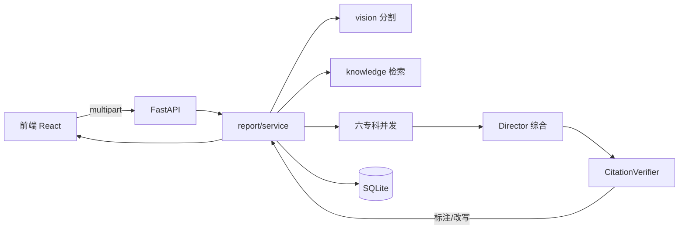

# OcuPanel

眼科（青光眼）多智能体诊断报告系统。上传一张眼底照加一段临床描述，系统完成
**视盘/视杯分割 → 证据检索 → 六专科并发会诊 → Director 综合成文 → 逐句引用校验 →
导出 Markdown / PDF**，并支持在报告基础上继续追问。

核心约束只有一条：**报告里每一句结论都必须能落到资料编号 `[n]` 上**。落不到的句子
会被改写或删除；实在改不动的，报告照常交付，但在界面上单独列出，请你人工复核。

---

## 功能

| 能力 | 说明 |
| --- | --- |
| 眼底图分析 | 分割视盘/视杯，计算杯盘比（CDR），输出叠加图 |
| 杯盘图示 | 报告顶部内嵌叠加图（绿色视杯/粉色视盘边界），标注 CDR，可点开大图 |
| 证据检索 | BM25 + 多语言向量双路召回，RRF 融合，带语言配额与门控 |
| 六专科会诊 | 青光眼、视光、青光眼专科、内科、技师、药师，并发执行 |
| 综合成文 | Director Agent 汇总六份专科意见，写成一份临床报告 |
| 引用校验 | 第 7 个 Agent 逐句核对 `[n]`；不通过则改写，仍不通过则标注交付 |
| 连续追问 | 报告进入会话上下文，可继续问治疗、随访、用药 |
| 多用户 | 注册/登录，每人可配置自己的 LLM 端点与 Key（加密存库） |
| 单服务部署 | FastAPI 直接托管前端构建产物，一个进程一个端口 |
| PDF 导出 | 服务端渲染，带分割图与参考文献 |

---

## 快速开始

前置：Python 3.11+（实测 3.13）、Node 18+、约 2 GB 磁盘（向量模型）。

```bash
git clone https://github.com/Hotpotfishsummer/OcuPanel.git
cd OcuPanel
bash start.sh                        # 一键：建 venv → 装依赖 → 构建前端 → 启动 → 开浏览器
```

脚本是幂等的：**缺什么补什么，已经在跑就只做健康检查并打开页面**。
首次运行会建 `.venv`、装依赖（约 2–5 分钟）、从 `.env.example` 生成 `backend/.env`、
构建前端，然后后台启动并等到服务真正应答才返回。

```bash
bash start.sh restart    # 改完配置重启
bash start.sh --no-open  # 不自动开浏览器
bash stop.sh             # 停止（先 SIGTERM，10 秒不退才 SIGKILL）
bash status.sh           # 进程 + HTTP 健康 + 最近日志，未运行返回退出码 1
tail -f logs/ocupanel.log
```

macOS 也可以在 Finder 里双击 `start.command`，效果等同 `bash start.sh`。

打开 <http://127.0.0.1:8000>。**首次生成报告**要下载/加载多语言向量模型
`intfloat/multilingual-e5-small`（约 470 MB），多等 30–60 秒；国内网络建议在
`.env` 里加 `HF_ENDPOINT=https://hf-mirror.com`。

脚本会检查的事，出错时直接告诉你怎么办：

| 检查 | 处理 |
| --- | --- |
| Python 版本 | 低于 3.11 直接报错退出 |
| 依赖缺失 | 自动 `pip install -r backend/requirements.txt` |
| `.env` 不存在 | 从 `.env.example` 复制并 `chmod 600` |
| 没配 LLM 端点 | 警告：能开页面，生成报告会 409 |
| 前端源码比产物新 | 自动 `npm run build` |
| 端口被别的程序占用 | 报占用 PID，不误杀 |
| 启动 60 秒没应答 | 打最后 20 行日志再退出 |

---

## 配置模型

配置分两层，**用户层永远优先**：

1. 用户在「个人设置」里填的 端点 / Key / 模型（存在 SQLite，Key 加密）；
2. 没填过就回落到 `backend/.env` 里的服务器默认值。

所以两种用法都成立：内网演示机配好默认值开箱即用；正式部署让每个人带自己的 Key。

`backend/.env` 最常改的几项：

```ini
OPENAI_BASE_URL=http://127.0.0.1:3425/v1   # 任意 OpenAI 兼容端点
OPENAI_MODEL=remote-magpie/minimax-cn/MiniMax-M3.1-Flash
OPENAI_API_KEY=                            # 本地网关留空即可，后端会自动补占位值

LLM_REASONING_EFFORT=low    # 推理型模型务必降强度，否则单次调用可能 100s+
LLM_CALL_TIMEOUT=90         # 单次调用硬上限，防网关长尾
REPORT_DEADLINE=210         # 整条流水线总预算，超时直接交付草稿

DEMO_AUTO_LOGIN=1           # 演示模式：跳过登录页，仅限本机/内网
```

完整变量表见 [docs/CONFIGURATION.md](docs/CONFIGURATION.md)。

---

## 架构一览



报告流水线的阶段、失败处理与耗时预算见 [docs/ARCHITECTURE.md](docs/ARCHITECTURE.md)。

---

## API

所有接口前缀 `/api`，除注册/登录/演示登录外都要 `Authorization: Bearer <token>`。

| 方法 | 路径 | 说明 |
| --- | --- | --- |
| POST | `/api/account/register` | 注册 |
| POST | `/api/account/login` | 登录，返回 token（7 天有效） |
| POST | `/api/account/demo-login` | 演示账号直登（需开启 `DEMO_AUTO_LOGIN`） |
| GET | `/api/account/me` | 当前用户 |
| PUT | `/api/account/llm` | 保存个人 LLM 配置 |
| GET | `/api/chat/conversations` | 会话列表 |
| POST | `/api/chat/conversations/{id}/messages` | 发消息（`{"message": "..."}`） |
| POST | `/api/generate-report-content/` | 生成报告，返回 JSON（前端用这个） |
| POST | `/api/generate-report/` | 生成报告并直接下载 PDF |
| GET | `/api/get-report-image/{name}` | 取分割图 |

请求字段、响应结构、错误码见 [docs/API.md](docs/API.md)。

---

## 开发

```bash
# 后端热重载（torch 会重复加载，仅在改代码时开）
RELOAD=1 python backend/main.py

# 前端热更新：5500 端口，/api 自动代理到 8000
cd frontend && npm run dev

# 测试
cd backend && python -m unittest discover -s tests -q
```

改完前端要 `npm run build`，FastAPI 托管的才是最新产物（`frontend/dist`）。

### 目录

```
backend/
  main.py            # FastAPI 入口、路由挂载、前端托管
  agents/            # 专科 Agent、Director、Verifier、并行编排
  chat/              # 会话与追问
  knowledge/         # 语料、BM25/向量检索、RRF 融合
  llm/               # OpenAI 兼容客户端、错误翻译、看门狗
  report/            # 报告流水线、PDF、HTTP 层
  user/              # 账户与个人 LLM 配置
  utils/             # 配置、SQLite、鉴权、路径
  tests/             # unittest
frontend/
  src/components/    # 聊天、报告、校验结果、设置
  vite.config.js     # 5500 + /api 代理
start.sh             # 一键启动（自检、装依赖、构建、等到健康）
stop.sh              # 停止
status.sh            # 进程 + HTTP 健康
start.command        # macOS 双击入口 → start.sh
local/               # 本机运行产物（pid 文件）+ 开机自启安装，不入库
samples/             # 示例眼底图、病历、样例报告
```

---

## 常见问题

**报告生成要多久？** 正常 1–2 分钟。日志里每次模型调用都会打一行
`[LLM] 12.3s in=2171 out=1680`，直接用它对时间。

**卡住不动？** 单次调用有硬上限（`LLM_CALL_TIMEOUT`，默认 90s），整条流水线有总预算
（`REPORT_DEADLINE`，默认 210s）。超预算会跳过校验直接交付草稿，不会无限转圈。

**界面提示「部分结论未核实」？** 校验没过的句子会被列出，报告仍然可用。想减少条目，
把病历描述写详细些，或调大 `RAG_TOP_K`。

**PDF 中文是空框？** 服务器缺 CJK 字体：`apt install fonts-noto-cjk`，或指定
`REPORT_FONT_PATH=/path/to/font.ttf`。

**接口返回 409？** 当前用户没配 LLM，且服务器也没给默认值。填 `.env` 或在设置页配置。

**代理报 `Invalid port: ':1]'`？** 你的 `NO_PROXY` 里有带括号的 IPv6。后端启动时会
自动清洗成裸 `::1`，一般无需处理。

---

## 安全说明

- `DEMO_AUTO_LOGIN=1` 时 `/api/account/demo-login` **不校验密码**，任何能访问该端口的人
  都会拿到演示账号。只在本机或内网演示环境开启。
- 用户 API Key 用 `OCUPANEL_SECRET_KEY` 派生的密钥加密后存 SQLite；换密钥会导致
  已存 Key 无法解密，需要用户重填。
- `.env`、`ocupanel.db`、`frontend/dist`、`logs/` 均已在 `.gitignore` 中，不要提交。

部署与运维见 [docs/DEPLOYMENT.md](docs/DEPLOYMENT.md)。

---

## License

见 [LICENSE](LICENSE)。
