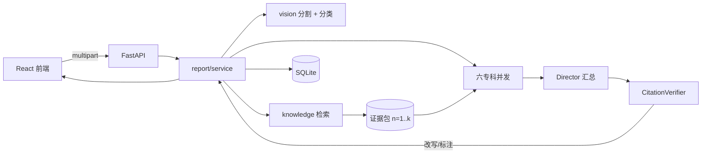

# OcuPanel 项目介绍

> 一份用来做介绍/演示的速览文档。想看细节请转 [ARCHITECTURE.md](ARCHITECTURE.md)、
> [API.md](API.md)、[CONFIGURATION.md](CONFIGURATION.md)。

---

## 一句话

**上传一张眼底照 + 一段病历描述，几分钟后拿到一份「每句结论都能追溯到资料」的青光眼诊断报告。**
报告可导出 Markdown / PDF，还能在报告基础上继续追问治疗、随访和用药。

### 30 秒版

眼科 AI 的难点不是「让大模型写一篇像样的报告」，而是**怎么写都像，但说不清依据**。
OcuPanel 把这件事拆成四段：先做影像分割拿到客观指标，再检索指南证据，然后让六个
专科 Agent 并发会诊，最后由主任 Agent 汇总成文，并由第七个 Agent **逐句核对引用**。
核对不过的句子会被改写；实在改不动的照常交付，但会在界面上单独列出来，让人判断。

---

## 要解决的问题

| 现状 | 后果 |
| --- | --- |
| 单次 LLM 生成临床报告 | 流畅但没依据，幻觉无法定位 |
| 专业问题被「一个通用模型」包办 | 药师该说的禁忌、技师该说的检查方法都会漏 |
| 报告错了只能整篇重写 | 等 2 分钟后拿到的东西可能还不如第一版 |
| 影像结果只是几个数字 | 医生无法确认模型到底圈了哪里 |

对应的四条设计原则：**证据可追溯、专科分工、标注交付而非拒答、影像结果可视化**。

---

## 做了什么

### 用户视角：四步

1. 登录后上传眼底照（或直接用 `samples/` 里的示例图），填病历描述；
2. 点击生成，界面显示阶段进度，1–2 分钟出报告；
3. 报告顶部是杯盘分割叠加图 + CDR 图注（点击可放大），正文每条结论带 `[n]`；
4. 全部通过校验就直接可读；有遗留条目时，报告上方出现校验条，逐条列出待人工复核的句子。

### 功能清单

| 能力 | 实现 |
| --- | --- |
| 眼底图分析 | SegFormer 分割视盘/视杯，算面积等效 CDR，输出叠加图 |
| 青光眼概率 | SwinV2 分类器输出概率，与 CDR 一起进入后续环节 |
| 证据检索 | BM25 + 多语言向量双路召回，RRF 融合，带语言配额 |
| 六专科会诊 | 青光眼、视光、青光眼专科、内科、技师、药师，线程池并发 |
| 综合成文 | Director Agent 汇总六份意见，写成一份临床报告 |
| 引用校验 | 第七个 Agent 逐句核对 `[n]`，改写或标注 |
| 连续追问 | 报告进会话上下文，可继续问治疗/随访/用药 |
| 多用户 | 注册登录，每人配置自己的 LLM 端点与 Key（加密入库） |
| 导出 | 服务端渲染 PDF（带分割图与参考文献），或 Markdown |
| 单服务部署 | FastAPI 同时托管 API 与前端构建产物，一个进程一个端口 |

---

## 用了什么

### 技术栈

| 层 | 选型 | 为什么 |
| --- | --- | --- |
| 后端 | Python 3.11+ / FastAPI / Uvicorn | 异步 HTTP + 自动文档，够轻 |
| 前端 | React 18 + Vite，手写 CSS | 无路由库，视图状态切换即可；`showdown` 渲染 Markdown |
| 影像 | PyTorch + Transformers（SegFormer、SwinV2） | 两个现成权重，无需自训练 |
| 检索 | BM25（自实现）+ `multilingual-e5-small` 向量 | 中文病历查英文指南必须跨语言 |
| LLM | OpenAI 兼容协议（`openai` SDK） | 换模型只改 `.env`，不碰代码 |
| 存储 | SQLite（WAL）+ PBKDF2 口令哈希 | 单机部署零运维 |
| 加密 | `cryptography` + `OCUPANEL_SECRET_KEY` 派生密钥 | 用户 API Key 不明文落盘 |
| PDF | fpdf2 + Noto CJK 字体 | 纯 Python，无需外部渲染服务 |
| 运维 | 三个 shell 脚本 + systemd | `start/stop/status` 一把梭 |

### 规模

- 后端 Python 约 **5.8k 行**，前端约 **4.4k 行**（不含依赖）；
- **10 个** unittest 文件、**37 个**测试用例；
- 知识库为 4 篇 Markdown 指南（诊断/治疗/随访/AAO PPP 英文版），按段落切块；
- 一次报告 4 类 LLM 调用：6 个专科（并发）+ 1 次汇总 + 校验/改写若干轮。

---

## 架构

分层很薄：`api.py` 只做参数绑定与鉴权，`service.py` 做编排和错误翻译，
`agents/` `knowledge/` `vision/` 不感知 HTTP，`llm/` `utils/` 是基础设施。

### 报告流水线

| 阶段 | 做什么 | 失败怎么办 |
| --- | --- | --- |
| 1. 视觉分析 | 分割 + 分类 + CDR，不调用 LLM | 无盘沿时给出警告，CDR 标注不可用 |
| 2. 证据检索 | 病历 + CDR 拼查询，召回 k 条带编号片段 | 召回为空则报告缺引用，校验会标出 |
| 3. 六专科并发 | 每专科最多 3 步工具调用（检索/读证据）后结论 | **单个失败只跳过该专科**，全挂才报错 |
| 4. Director | 汇总六份意见写成临床报告 | 超预算则直接交付草稿 |
| 5. 引用校验 | 逐句核对 → 有问题改写 → 复核 | 仍有余留 → `partial`，交付并列出 |
| 6. 落库返回 | 存报告与两条消息，`meta` 带校验结果 | — |

校验状态有明确语义：`pass` / `rewritten` / `partial` / `disabled` / `rejected`，
只有「正文为空」的 `rejected` 不交付。交付前还会摘掉对不上任何证据的 `[n]`——
**标注交付不等于放行伪造引用**。

---

## 三个可以展开讲的技术点

**1. 引用校验「不阻断」**

早期版本在仍有断言无依据时直接拒答，用户等了两分钟什么也没拿到。现在改为
「标注交付」：报告可用，风险显式列出。同理，`VERIFY_REGENERATE`（整篇重生成）保留
但默认关闭——实测常常只是换套说法把同样的幻觉写回来，还更慢。

**2. 混合检索的语言配额与门控**

中文病历查英文指南时，纯 BM25 完全失效，纯向量又会被中文块占满 top-k。做法是两路
RRF 融合，再加两个机制：**语言配额**保证每种语言至少保留 `k / 语言数` 个位置；
**配额门控**只在最佳命中足够强时启用配额。门控是必需的——跨语言相关块的余弦（0.82–0.84）
低于同语言无关块（0.85–0.87），用绝对阈值必然误杀。启动时会用探针复核门控值。

**3. 三层超时保护**

传输层 `LLM_TIMEOUT`（120s）/ 单次调用看门狗 `LLM_CALL_TIMEOUT`（90s）/
流水线总预算 `REPORT_DEADLINE`（210s）。看门狗是关键：httpx 的 timeout 只管两次
数据之间的间隔，网关偶尔吐几个字节就能一直重置，实测出现过单次调用 277 秒的情况。
看门狗把每次等待硬截断，被放弃的线程自行结束，不阻塞后续阶段。

---

## 已知限制与后续

- **病种只有青光眼**：`vision/diseases/` 已按病种分目录，新增病种是加一个子包；
- **知识库很小**：4 篇指南，够演示不足以支撑真实临床；GraphRAG 目录是留好的 stub；
- **单图单眼**：没有双眼配准、没有 OCT/视野结构化输入；
- **不是医疗器械**：不做临床验证，输出仅供演示与讨论；
- **横向扩展**：目前单进程单机，检索与分割都要拆出去才能多实例。

---

## 演示动线（约 5 分钟）

0. 启动：`bash start.sh`（缺依赖会自动装，起好自动开浏览器）；
1. **30 秒**：讲一句话定位 + 那句「每句结论都能落到资料上」的约束；
2. **60 秒**：打开界面，上传 `samples/fundus_right_eye.png` + `samples/clinical_note.txt`；
3. **90 秒**：等报告的同时讲流水线那张图（分割 → 检索 → 六专科 → 汇总 → 校验）；
4. **60 秒**：报告出来，先指顶部叠加图和 CDR，再指正文里的 `[n]`，最后看校验条；
5. **60 秒**：追问一句「这个患者需要哪些随访检查」，展示会话上下文复用；
6. **收尾**：展示 PDF 导出，讲三个技术点和已知限制。

素材都在 `samples/`：示例眼底图、病历文本、中英文样例报告、分割叠加图。
